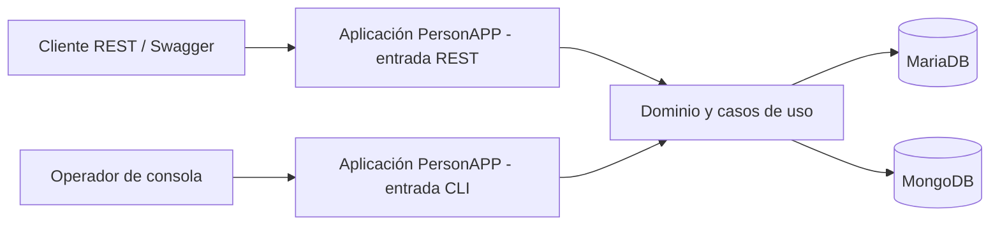
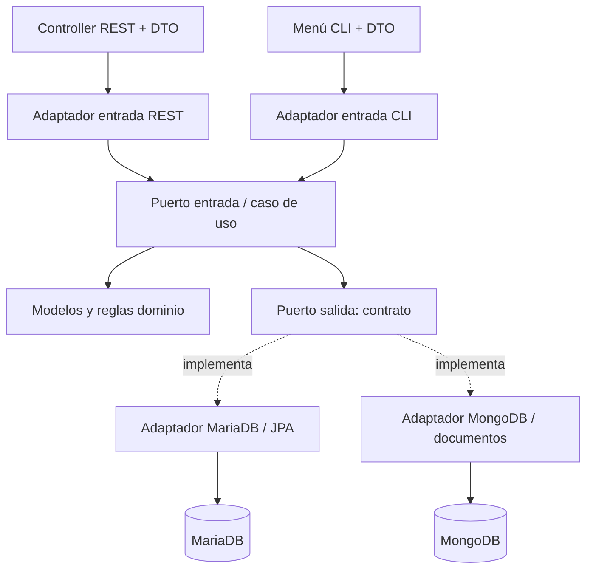

# SAD / HLD · Documento de arquitectura de software

**Proyecto:** PersonAPP · Laboratorio 2  
**Estado:** especificación de diseño basada en enunciado y plantilla de referencia; verificación de implementación pendiente  
[← Arquitectura](README.md) · [SRS](../01-producto/01-SRS.md) · [Backlog](../06-backlog/README.md)

## 1. Propósito, alcance y contexto

Diseñar la solución del Laboratorio 2 para gestionar **Persona, Profesión, Teléfono y Estudios** mediante **REST y CLI**, con persistencia alternativa en **MariaDB y MongoDB**. Es una **aplicación Java/Spring Boot Maven multimódulo**, no siete microservicios. El objetivo principal es demostrar arquitectura hexagonal (puertos y adaptadores), Repository y Service/casos de uso, así como **selección del motor durante la ejecución, sin reinicio**. [SRS](../01-producto/01-SRS.md).

La plantilla original reporta Java 11 y Spring Boot 2.7.11. La entrega se ejecuta y diagnostica con JDK 11.

## 2. Drivers arquitectónicos

| Driver | Respuesta de diseño | Verificación / HU |
|---|---|---|
| RA-01 independencia de negocio | `domain` sin frameworks ni dependencias de adaptadores | HU-027 |
| RA-02 puertos, Service, Repository | `application` define contratos y orquesta casos de uso; adaptadores implementan salida | HU-012, HU-016, HU-019, HU-022, HU-027 |
| RF-02 y RF-03 dos entradas | Adaptadores REST y CLI independientes, núcleo común | HU-014/015, HU-018/021/024 |
| RF-04 dos motores | Adaptadores Maria/JPA y Mongo/documentos bajo contratos de salida | HU-013, HU-017, HU-020, HU-023 |
| RF-05 cambio de motor | Resolución del puerto de salida por petición/acción, sin reiniciar | HU-025 |
| RF-06/08 integridad y mapeos | DTO, mappers, validaciones comunes y pruebas negativas | HU-006, HU-011, HU-026/027 |
| RT-03 API documentada | OpenAPI/Swagger contrastado contra endpoints implementados | HU-028 |

## 3. Vista de contexto

Actores: usuario de consola, consumidor HTTP/Swagger y equipo que despliega/verifica. Sistemas externos: MariaDB y MongoDB como almacenes alternativos; no existe Kafka, API Gateway, frontend Angular ni sincronización obligatoria entre los motores.

El flujo es conceptual; los accesos físicos a ambos motores ocurren **solo** a través de adaptadores y puertos, nunca desde el dominio.

## 4. Vista de módulos Maven

| Módulo | Responsabilidad y contenido permitido |
|---|---|
| `common` | Tipos compartidos estrictamente transversales, evitando contaminación del dominio |
| `domain` | `Person`, `Profession`, `Phone`, `Study`, `Gender` y reglas puras |
| `application` | Puertos de entrada/salida y casos de uso; `PersonInputPort`, `PersonOutputPort`, `PersonUseCase` como referencias iniciales |
| `rest-input-adapter` | Arranque REST, controladores, DTO, mapper HTTP, OpenAPI |
| `cli-input-adapter` | Arranque CLI, menús, DTO y mapper de consola |
| `maria-output-adapter` | Implementaciones de puertos, entidades JPA, repositories y mappers MariaDB |
| `mongo-output-adapter` | Implementaciones de puertos, documentos, repositories y mappers MongoDB |

**Importante:** confirmar `pom.xml` y `mvn dependency:tree` en HU-002/HU-027. La separación conceptual no garantiza por sí misma la dirección de dependencias compiladas. La ruta `common` es transversal, no una licencia para introducir Spring en el dominio.

## 5. Vista lógica, contratos y composición

El modelo muestra **dirección conceptual de colaboración**. En compilación, los adaptadores de salida deben **depender de las abstracciones**, y no al revés. La composición Spring conecta implementaciones; el selector recibe el motor solicitado por entrada. No se asume un `@Primary` global mutable para cada petición.

## 6. Vista de datos

Modelo relacional inicial reportado: `persona(cc PK, nombre, apellido, genero, edad)`, `profesion(id PK, nom, des)`, `telefono(num PK, oper, duenio FK a persona)`, `estudios(id_prof, cc_per PK compuesta, fecha, univer; FK a profesion y persona)`. En MongoDB, la identidad, vínculos y estrategia de documentos deben quedar especificados en [persistencia](../03-contratos/persistencia.md) y validados. No se presupone replicación, consistencia cruzada ni un mismo identificador físico.

## 7. Vista dinámica y comportamiento

- REST → controlador → adaptador de entrada → caso de uso → puerto salida → adaptador elegido → motor → respuesta.
- CLI → menú → adaptador de entrada → el **mismo** caso de uso → puerto salida → adaptador elegido → motor → salida.
- Cambio `MARIA → MONGO → MARIA` durante la **misma ejecución** con evidencia (HU-025).

Detalle en [estilo-y-flujo](estilo-y-flujo.md) y [comportamiento-del-flujo](comportamiento-del-flujo.md).

## 8. Despliegue y restricciones

Se describen dos **puntos de arranque** REST y CLI del proyecto original. Aún debe comprobarse si se ejecutan como procesos separados, perfiles o comandos distintos. MariaDB y MongoDB son dependencias de runtime; no se exige Docker ni despliegue cloud por defecto. Scripts DDL/DML del fork, secretos fuera de Git. Puertos reportados en la plantilla (REST 3000, MariaDB 3307, MongoDB 27017) son **valores iniciales sujetos a comprobación**, no garantía para la versión migrada.

## 9. Decisiones y riesgos

- El enunciado pide arquitectura hexagonal con Repository y Service, CRUD, JDK 11, ambos clientes, ambos motores, Swagger 3 y los entregables. El cambio de motor en caliente es un criterio del equipo.
- Propuesto para aprobación: estrategia precisa de selección del puerto, políticas de error, identidades Mongo, compatibilidad y versiones concretas. Consultar [ADR](decisiones-adr.md) y [puntos abiertos](puntos-abiertos.md).
- Riesgo: migrar antes de reproducir defecto del Mapper mezcla fallos de origen y de compatibilidad. Ver [riesgos](riesgos-y-supuestos.md).

## 10. Correspondencia con el backlog

| Etapa | HU | Artefacto o evidencia |
|---|---|---|
| Baseline | HU-001 a HU-006 | Inventario de módulos, arranque y diagnóstico Mapper |
| Funcionalidad | HU-011 a HU-024 | Puertos, casos de uso, repositorios, entradas CRUD |
| Verificación | HU-025 a HU-028 | Cambio en caliente, E2E, auditoría, OpenAPI |
| Entrega | HU-029 a HU-032 | README, informe, demo y tag |

## 11. Criterios de aceptación del SAD

- La arquitectura definida tiene trazabilidad a SRS y a las HU.
- Diagramas editables y sus descripciones reflejan la misma estructura.
- Las decisiones propuestas se distinguen explícitamente de las aprobadas y de las implementadas.
- Se conserva la frontera entre `domain`/`application` y adaptadores.
- No se afirma que se haya ejecutado una prueba solo porque el diseño la exige.

## 12. Contraste con la implementación inspeccionada

La vista anterior es diseño objetivo. Hoy `application` tiene solo puertos y caso de uso Persona, usa `@Qualifier` de Spring y `@UseCase` de common; common depende de Spring Context. `domain` usa Lombok y hereda dependencias del padre. Las entradas crean manualmente `PersonUseCase`; REST conserva el puerto seleccionado en un campo mutable compartido. Existen dos clases SpringApplication distintas; los comandos y procesos no se ejecutaron. Véanse [SDD real](../04-implementacion/03-SDD-LDD.md). No se modifica el diseño deseado para aparentar cumplimiento.
