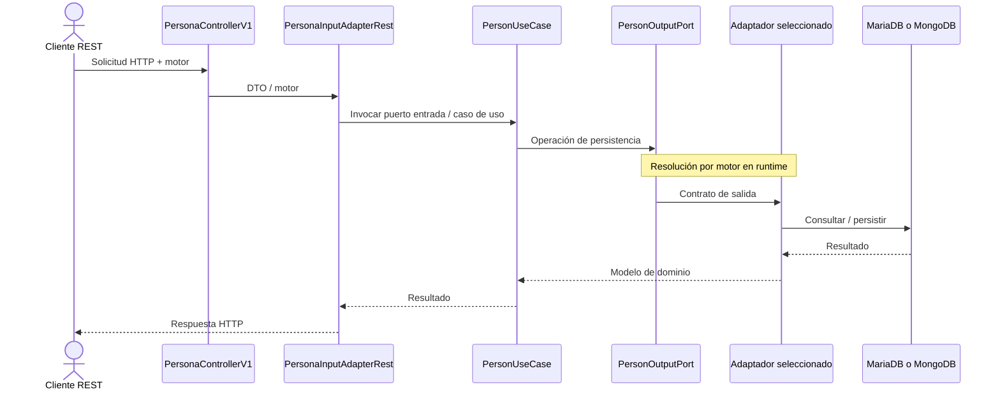
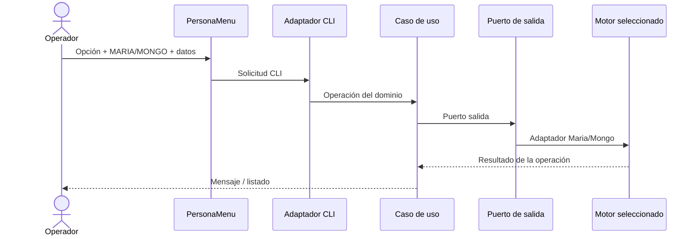

# Estilo y flujos end-to-end

**Proyecto:** PersonAPP · Laboratorio 2  
**Estado:** especificación de diseño basada en enunciado y plantilla de referencia; verificación de implementación pendiente  
[← Arquitectura](README.md) · [SRS](../01-producto/01-SRS.md) · [Backlog](../06-backlog/README.md)

## Estilo

**Arquitectura hexagonal con puertos y adaptadores**, organizada como proyecto Maven multimódulo. Dos adaptadores de entrada (REST y CLI) invocan casos de uso comunes, y dos adaptadores de salida (MariaDB y MongoDB) implementan contratos de persistencia.

## Flujo REST

`PersonaControllerV1`, `PersonaInputAdapterRest`, `PersonUseCase` y `PersonOutputPort` son identificadores reportados para el **repositorio original**, no afirmaciones sobre nombres posteriores a migración. El paso real de selección de motor debe observarse en código (HU-002/HU-025).

## Flujo CLI

## Secuencia de demostración

1. Arrancar REST/CLI según las instrucciones reales del fork.
2. Crear/consultar un recurso en MariaDB; comprobar la base.
3. Crear/consultar un recurso distinto en MongoDB sin detener el cliente.
4. Volver a MariaDB y consultar los datos originales; comprobar que no se sincronizaron automáticamente.
5. Repetir el patrón con relaciones persona-teléfono y persona-profesión-estudios.
6. Ensayar un identificador inexistente y motor desconocido, comparando con contratos de errores.

**Criterio verificable:** la alternancia se demuestra en la misma sesión/ejecución (HU-025), y el flujo CRUD completo en la matriz de [calidad](atributos-de-calidad.md) y HU-026. Los comandos reales y resultados van en `04-implementacion/pruebas/`.
