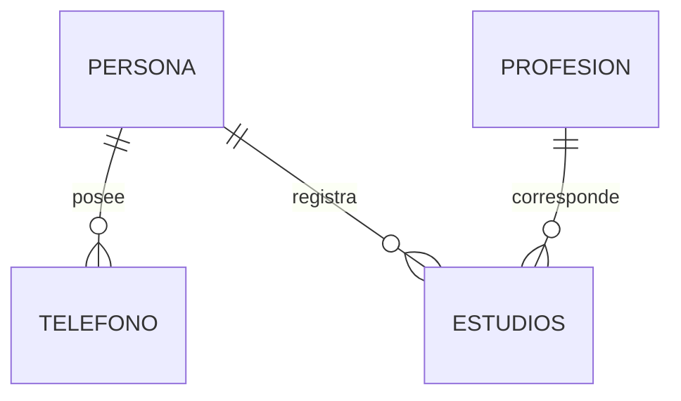

# Contrato de persistencia · MariaDB y MongoDB

**Estado:** modelo MariaDB extraído de la referencia; esquema/documentos MongoDB y decisiones del equipo por verificar.  
[← Contratos](README.md) · [SAD](../02-arquitectura/02-SAD-HLD.md) · [ADR-003](../02-arquitectura/adr/ADR-003-modelo-persistencia.md)

## 1. Propósito

Asegurar que los casos de uso gestionen las cuatro entidades con **dos adaptadores de salida intercambiables**, conservando identidad, reglas y relaciones sin acoplar el dominio al motor físico. MariaDB y MongoDB son **almacenes alternativos**, no réplicas automáticamente sincronizadas.

## 2. Modelo relacional base: MariaDB

| Tabla | Clave | Campos observados | Relaciones |
|---|---|---|---|
| `persona` | `cc` | `nombre`, `apellido`, `genero`, `edad` | referenciada por teléfono y estudios |
| `profesion` | `id` | `nom`, `des` | referenciada por estudios |
| `telefono` | `num` | `oper`, `duenio` | `duenio` → `persona.cc` |
| `estudios` | compuesta `(id_prof, cc_per)` | `fecha`, `univer` | `id_prof` → `profesion.id`; `cc_per` → `persona.cc` |

Este es el **modelo de referencia**, no el resultado ya probado del fork. Precisar en `scripts/persona_ddl_maria.sql` tipos, tamaños, nulabilidad, checks, índices y política de borrado antes de derivar reglas exactas. Conservar la clave compuesta de estudios salvo modificación formal justificada.

## 3. MongoDB: contrato de equivalencia funcional

**La estructura inicial sí existe en el código; su validación y evolución definitivas siguen pendientes.** El equipo debe contrastar el DDL/DML MongoDB y los adaptadores iniciales, y registrar una representación que permita estas invariantes:

| Agregado | Identidad lógica | Relación a preservar | Verificación requerida |
|---|---|---|---|
| Persona | cédula | tiene teléfonos y estudios asociados | alta/lectura/edición/baja sin cambio de identidad |
| Profesión | identificador | referenciada por estudios | conservación y consulta de vínculos |
| Teléfono | número | dueño (`cc`) existente | evitar huérfanos y duplicados |
| Estudios | combinación profesión + persona | ambas referencias lógicas existentes | evitar pares duplicados y ediciones ambiguas |

MongoDB no implementa FKs SQL por defecto. La aplicación debe hacer cumplir relaciones y unicidad con validaciones, índices/estrategias aprobadas y pruebas reales. No afirmar que documentos embebidos o colecciones separadas están aprobados antes de inspeccionar la plantilla y [ADR-003](../02-arquitectura/adr/ADR-003-modelo-persistencia.md).

## 4. Scripts de referencia y orden de validación

| Motor | Archivos citados en plantilla | Comprobación |
|---|---|---|
| MariaDB | `scripts/persona_ddl_maria.sql` | Base/tablas/PK/FK creadas sin error |
| MariaDB | `scripts/persona_dml_maria.sql` | Registros de demostración insertados y consultables |
| MongoDB | `scripts/persona_ddl_mongo.js` | Colecciones/índices/validadores según código base |
| MongoDB | `scripts/persona_dml_mongo.js` | Documentos insertados en base correcta y consultables |

**Riesgo concreto detectado en los materiales:** configuración Spring MongoDB usa `persona_db`, mientras que un script DML de referencia selecciona `prueba_db`. HU-004 debe comprobarlo y corregir la discrepancia de forma trazable; no elegir un nombre arbitrariamente sin registrar el resultado.

Registrar comando, usuario no sensible, versión de cliente/motor, base efectivamente creada, recuento de datos, error si lo hay y evidencia de cada archivo ejecutado.

## 5. Contratos de puertos y repositorios

Los casos de uso deben hablar con interfaces de salida de `application`, no con tipos de Spring Data/JPA. Como antecedente, `PersonOutputPort` declara funciones `save`, `delete`, `find` y `findById` en la plantilla. El alcance de profesión, teléfono y estudios deberá cerrarse en HU-011 a HU-023 con nombres y firmas efectivos.

| Responsabilidad | Núcleo | Implementación externa |
|---|---|---|
| Entidades y reglas | `domain` | Sin anotaciones de JPA/Mongo |
| Contratos y casos de uso | `application` | Sin conexión física |
| Persistencia relacional | puerto de salida | `maria-output-adapter`, repositorios JPA y mapper |
| Persistencia documental | mismo contrato lógico | `mongo-output-adapter`, repositorios Mongo y mapper |

**Importante:** no compartir entidades JPA/documentos Mongo como objetos de dominio, ni resolver selección dinámica con `@Primary` fijo que impida cambiar por petición.

## 6. Operaciones e invariantes para ambos motores

| Operación | Invariante objetivo |
|---|---|
| Crear | Clave única, datos válidos, relaciones existentes, resultado visible solo en motor solicitado |
| Listar/consultar | Lecturas coherentes del motor elegido; vacío y ausencia diferenciados |
| Editar | Identidad inmutable salvo política explícita; no generar registros huérfanos |
| Eliminar | Aplicar política de integridad aprobada de forma equivalente en ambas bases |
| Cambio de motor | No se reinicia proceso ni se mueven automáticamente los registros |
| Fallo del motor | Se devuelve error controlado sin redirigir escritura al otro almacén |

**Pendiente de decisión:** borrado restrictivo, cascada o manejo explícito de dependientes. No imponer una regla heredada de PersonAPI .NET: fijar en HU-011, en [ADR-003](../02-arquitectura/adr/ADR-003-modelo-persistencia.md) y en [validaciones](validaciones-y-errores.md).

## 7. Prueba mínima de aislamiento y selección dinámica (HU-025)

1. Crear una persona de prueba en `MARIA` y comprobar su presencia mediante consulta física/adapter MariaDB.
2. Consultar esa misma clave en `MONGO` y documentar ausencia, salvo que exista allí de forma independiente.
3. Crear un registro distintivo en `MONGO` y comprobarlo en MongoDB.
4. Volver a `MARIA` sin reiniciar y verificar que sus registros no cambiaron.
5. Repetir alternancia desde REST y CLI; comprobar errores al introducir selector inválido.

Usar identificadores de prueba controlados y limpiar solo los datos generados por el escenario. No asumir que consultar motores alternos devuelve los mismos datos.

## 8. Evidencia pendiente de fijar

- DDL/DML reales, campos/tipos/nulabilidad; colección/documento/índices de Mongo.
- Decisiones de identidad, relación, eliminaciones y transacciones.
- URL/credenciales de desarrollo **fuera del repositorio** y versiones reales en [`versiones.md`](../04-implementacion/versiones.md).
- Pruebas de persistencia reales para cada recurso y cada motor, enlazadas a HU-013/017/020/023 y HU-026.

## 8. Representación física existente verificada por lectura

`PersonaDocument`: `_id` Integer, nombre, apellido, genero, edad; telefonos y estudios son referencias inversas de solo lectura. `ProfesionDocument`: `_id` Integer, nom, des y estudios inversos. `TelefonoDocument`: `_id` String (número), oper y `primaryDuenio`. `EstudiosDocument`: `_id` String construido como `ccPersona-idProfesion`, `primaryPersona`, `primaryProfesion`, fecha LocalDate y univer. Los enlaces usan `@DocumentReference(lazy=true)`; no son subdocumentos embebidos ni FK garantizadas por Mongo. Solo existe `PersonaRepositoryMongo` (ID Integer).

SQL: cc e id son INT (el ancho `(15)` o `(6)` no amplía su rango); nombre/apellido VARCHAR(45), genero ENUM M/F no nulo, edad INT nullable. Teléfono num VARCHAR(15), oper VARCHAR(45), dueño no nulo; profesión nom VARCHAR(90), descripción TEXT; estudios fecha DATE y univer VARCHAR(50) nullable, PK `(id_prof, cc_per)`. No hay CHECK de edad ni ON DELETE CASCADE explícito. JPA declara cascadas ALL desde Persona y Profesión, por lo que el efecto ORM requiere pruebas separadas.

**Discrepancia preservada:** `persona_dml_mongo.js` usa `prueba_db`; propiedades de ambas aplicaciones y permisos creados por DDL Mongo usan `persona_db`. El DDL Mongo crea usuario en admin, no define validadores/colecciones de los cuatro recursos. Los dos DML insertan únicamente cinco personas. El DDL Maria elimina esquema y usuario antes de recrearlos: revisar sobre bases de prueba antes de ejecutarlo. Ningún script se ejecutó ni se modificó en esta revisión.
